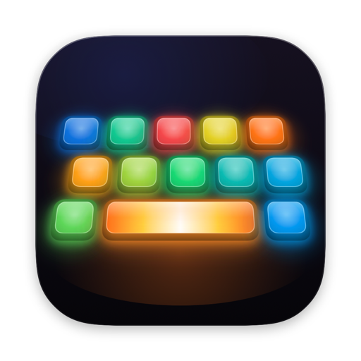
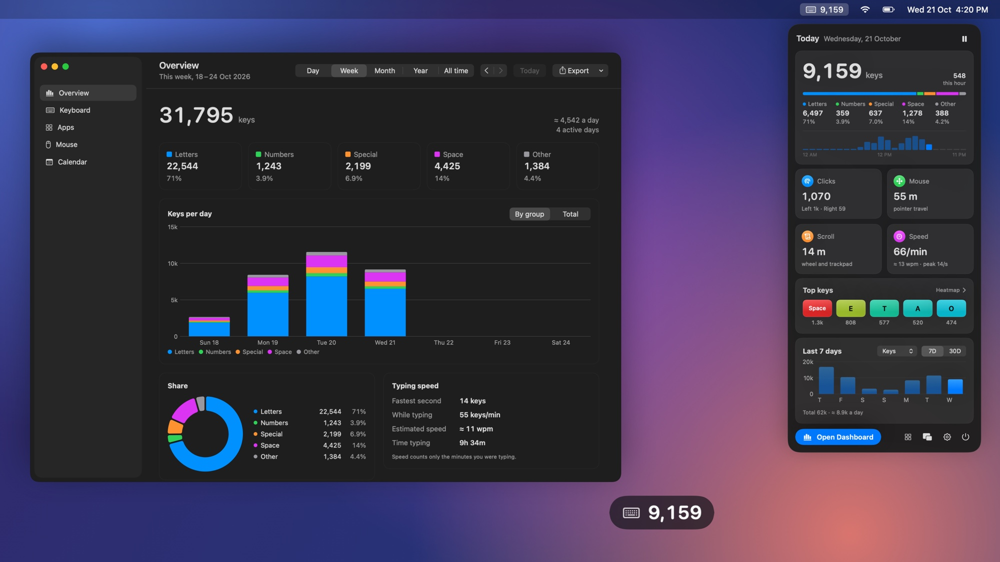
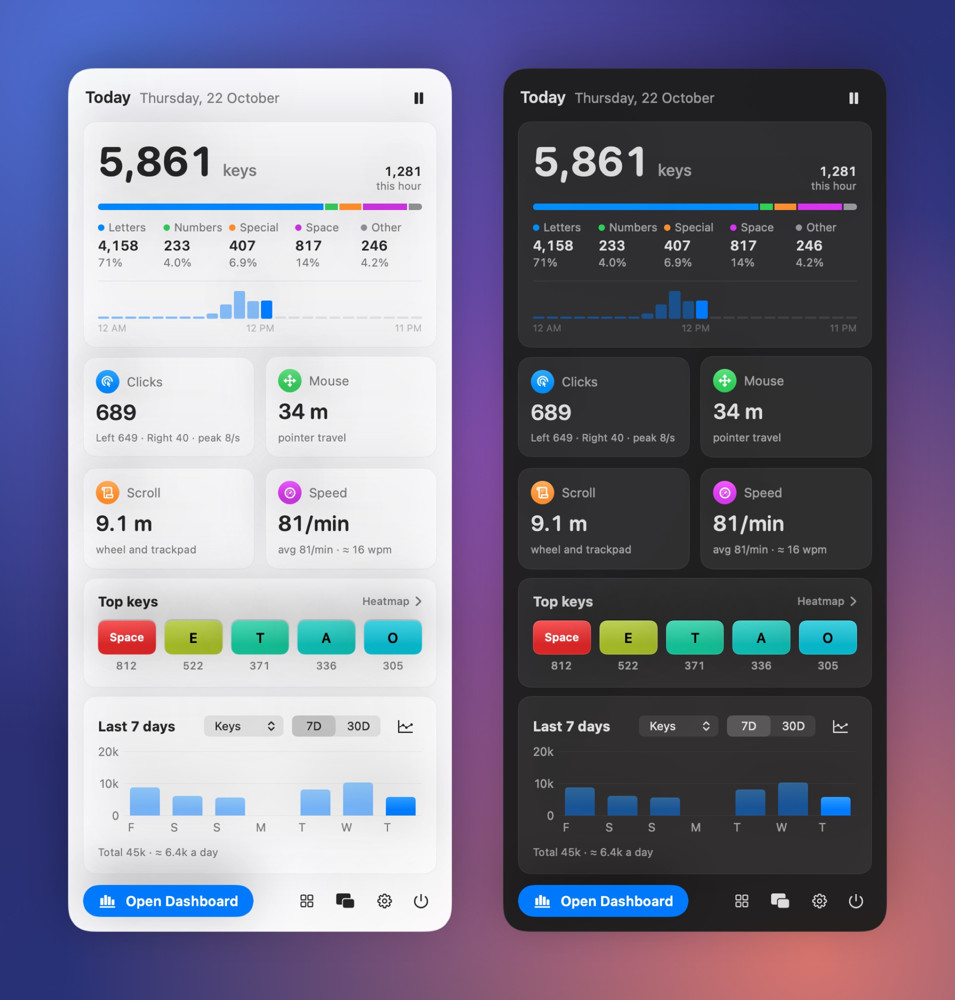
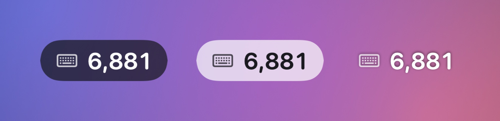
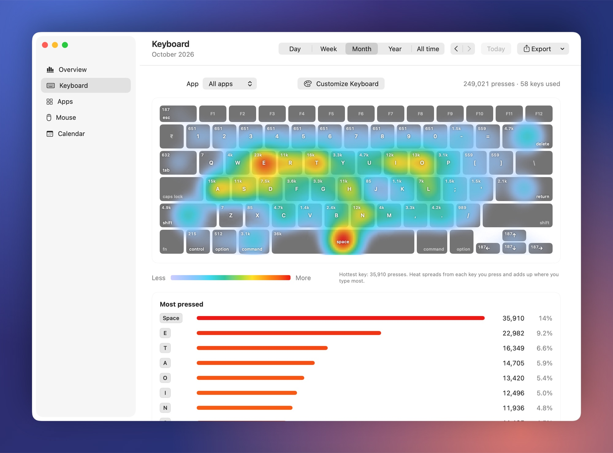
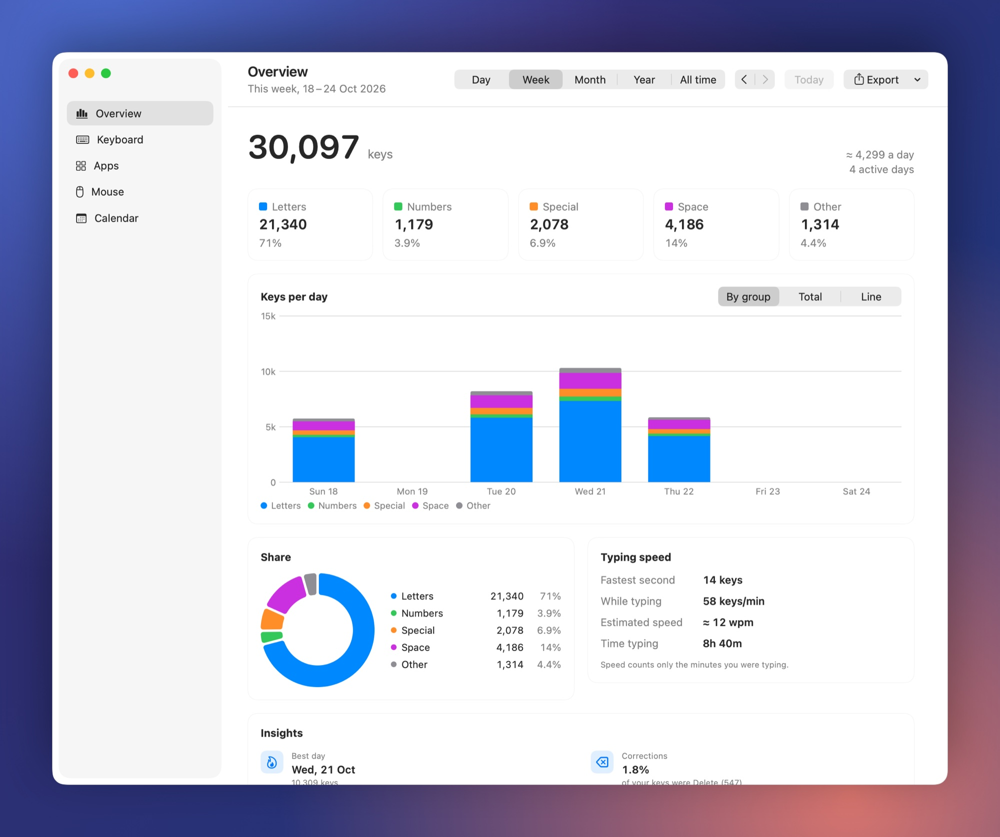
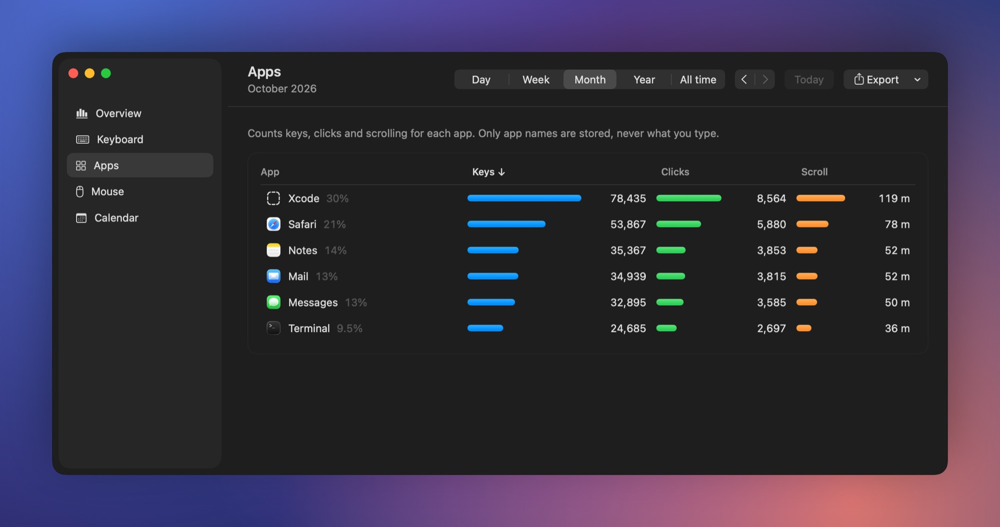
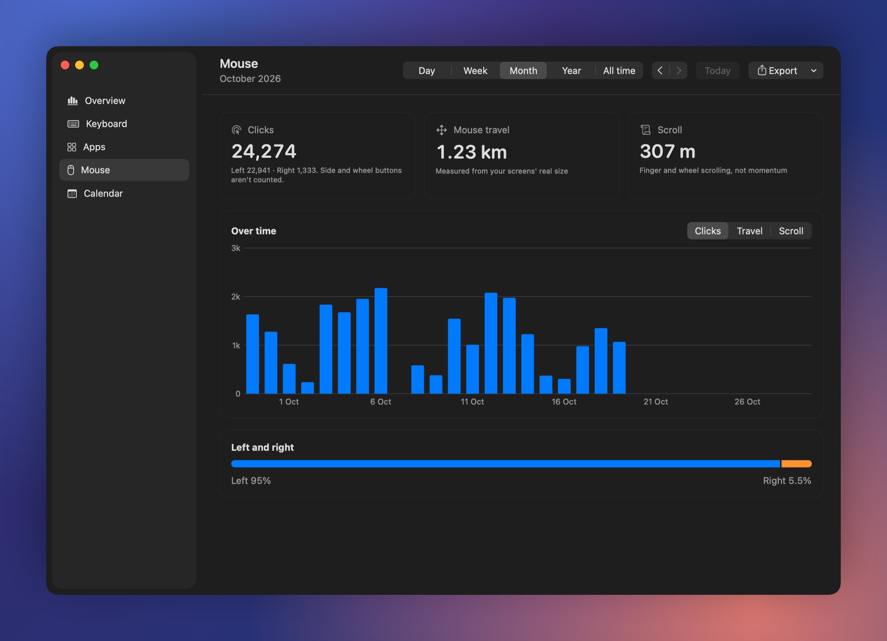
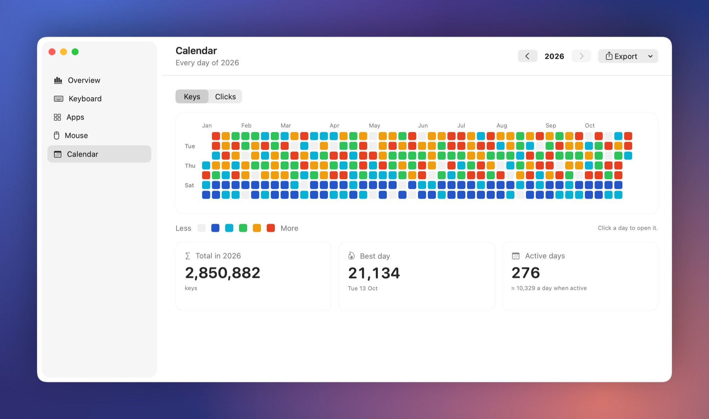
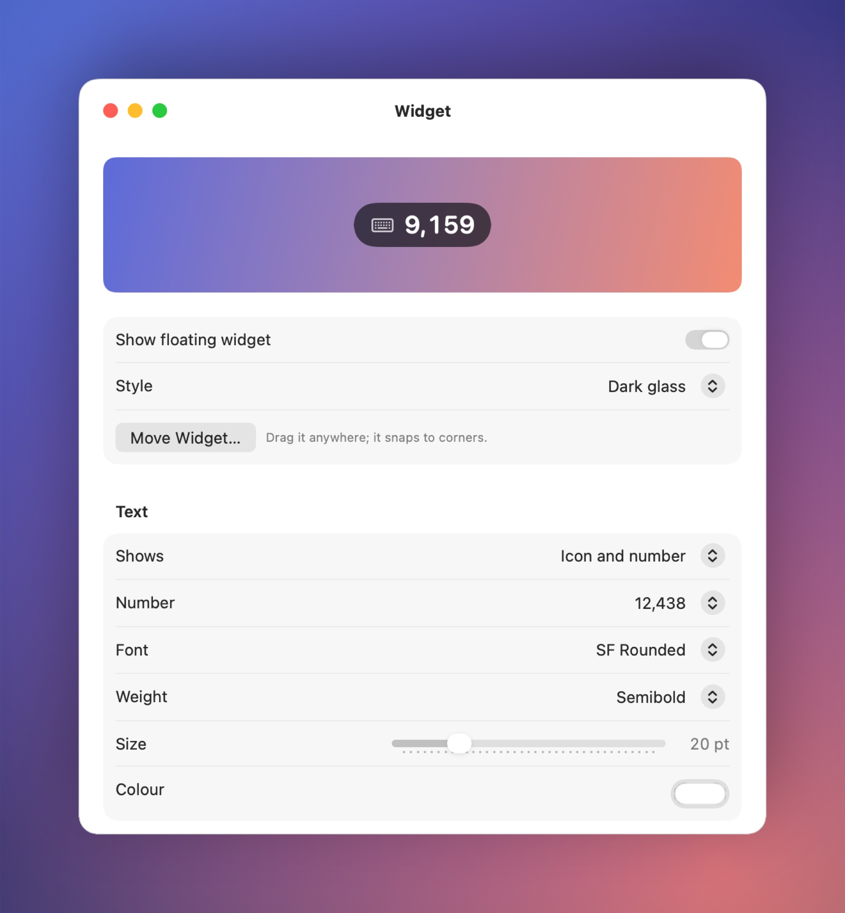

<div align="center">



# Keylog

**The private keystroke counter and keyboard heatmap for macOS.**

Count every key you press and see your typing speed (WPM), clicks and mouse distance by day, week, month and year. A native menu bar app that never records what you type and stays offline unless you turn on update checks.




</div>

<br>

## Download

<p align="center">
  <a href="https://github.com/irfanabdulhameed/keylog/releases/latest/download/Keylog.dmg"></a>
</p>

<p align="center">Requires macOS 14 Sonoma or later. Free and open source.</p>

**The first time you open it:**

1. Open **Keylog.dmg** and drag **Keylog** onto **Applications**.
2. Open Keylog from Applications. Keylog isn't notarized by Apple yet, so macOS says it can't check it. Click **Done** (or **OK**).
3. Open **System Settings › Privacy & Security**, scroll down to **Security**, and click **Open Anyway** next to the line about Keylog. Confirm with your password or Touch ID, then click **Open**.
4. Keylog asks for **Input Monitoring**. Switch it on in the same Privacy & Security pane and Keylog starts counting by itself.

You only do this once. To get new versions without visiting this page, turn on **Check for updates automatically** in Settings › General. It's off until you do.

<br>

## Why Keylog

You type tens of thousands of keys a day. Keylog shows you how: which keys work hardest, when you're fastest, which apps take your words, how far your mouse travels. And it does it without ever knowing what you typed.

- **Counts, never records.** Keylog stores how many times each key was pressed, per hour. Never the text, never the order, never where you clicked.
- **Nothing leaves your Mac.** No analytics, no accounts, no cloud. The only connection Keylog can make is to GitHub, to check for its own updates, and that stays off until you switch it on.
- **Truly native.** Swift, SwiftUI and AppKit. No Electron, no web views, no third-party libraries. About 0% CPU at rest and around 40 MB of memory.
- **Made for macOS 26.** Liquid Glass panel and widget, with a frosted fallback on macOS 14 and 15.

> Looking for a free, open-source **WhatPulse** or **KeyStats** alternative that stays offline? You've found it.

## Everything Keylog does

| Counting | Insights | On screen | Your data |
|---|---|---|---|
| Keystrokes per key, per app, per hour | Typing speed: live, average and WPM | Glass panel in the menu bar | One local SQLite file |
| Letters, numbers, special, space and other | Keyboard heatmap for any period | Floating counter with key-press pulse | CSV and JSON export |
| Left and right clicks, clicks per second | Best day, busiest hour and weekday | Menu bar icon coloured by speed | Import a backup |
| Mouse travel and scroll in real metres | Correction rate (Delete presses) | Milestone notifications | Reset today or everything |
| Fastest second and time spent typing | Year calendar of every day | Line or bar charts | Per-keyboard on/off switches |

<br>

## Features

<table>
<tr>
<td width="52%"></td>
<td>

### Today, one click away

Click the keyboard icon in the menu bar for a glass panel with everything about today:

- Total keys, split into **letters, numbers, special characters, space and other keys**, with counts and percentages
- Keys per hour, with the current hour live
- Left and right clicks, mouse travel and scroll distance in real metres
- Typing speed **live as you type**, your average while typing, estimated WPM and your fastest second
- Clicks per second at your quickest
- Your five hottest keys, drawn as heat-coloured keycaps
- The last 7 or 30 days, by keys, clicks, mouse or scroll, as bars or a line

Right-click or ⌃-click the icon for a quick menu.

</td>
</tr>
</table>

<table>
<tr>
<td>

### A counter that floats

A tiny glass pill shows today's total over everything you do, on every desktop and over full-screen apps.

- **Never in the way:** clicks pass straight through, and it fades when your pointer comes near
- **Feels alive:** a gentle 1% pulse on every key press, off with Reduce Motion
- **Yours to style:** dark glass, light glass or text only; any font, size, weight, colour, shape and opacity
- **Snaps into place:** drag it anywhere, it snaps to the corners and remembers its spot on each display
- Hold ⌃ and click it for the menu

</td>
<td width="52%"></td>
</tr>
</table>

### The keyboard heatmap

Every key coloured by how hard it works, on a real thermal scale from cold blue to red. A log scale keeps quieter keys visible next to Space and E. Hover any key for its exact count and share, filter by app, and look at a day, a week, a month, a year or all time.



Keys are counted by their physical position, so switching between QWERTY, AZERTY, Dvorak or any input source never scrambles your history. Labels follow your current layout.

### A dashboard for the long view

Day, week, month, year or all time, with keyboard shortcuts for all of it (⌘1 to ⌘5, ⌘← ⌘→, ⌘T). Bars stack by key group, or switch to totals or a line; hover for exact numbers, click a bar to open that day or month.

An **Insights** card picks out what stands out: your best day or busiest hour, your most active weekday, how often you reach for Delete, your fastest clicking, and how far your mouse travelled in football pitches or marathons.



<table>
<tr>
<td width="50%">

**Apps.** Which apps take your keys, clicks and scrolling. Click one to see its own keyboard heatmap.



</td>
<td width="50%">

**Mouse.** Left and right clicks, real-world travel measured from your screens' physical size, and scrolling.



</td>
</tr>
</table>

**Calendar.** A whole year at a glance, one square per day, coloured by how much you typed. Click any day to open it.



### Settings that feel like macOS

A proper Settings window with toolbar tabs: launch at login, what the menu bar shows, a menu bar icon that turns green, yellow and red as you type faster, milestone notifications ("10,000 keys today"), which day your week starts, per-app, mouse and per-keyboard tracking, every widget option with a live preview, CSV and JSON export, backup import, and resets that ask before they act.

<div align="center">

</div>

<br>

## Privacy, in detail

Keylog needs the macOS **Input Monitoring** permission to see key presses. It uses a *listen-only* event tap: it can't change, block or delay anything you type, and macOS hands it a copy of each event after it reaches your app.

| Keylog stores | Keylog never stores |
|---|---|
| How many times each physical key was pressed, per day and per app | The characters you type |
| Counts for letters, numbers, special characters, space and other keys, per hour | The order of your keys |
| Left and right clicks, mouse travel and scroll distance | Where you click, or what's on screen |
| The name of the app in front (can be turned off) | Window titles, URLs or file names |

- Everything lives in one SQLite file: `~/Library/Application Support/Keylog/keylog.sqlite`. Open it with any SQLite tool and see for yourself.
- The character a key types is used for one thing only, deciding its group, and then discarded. You can check: it's [one function](Sources/KeylogCore/KeyClassifier.swift).
- Password fields are hidden from every app by macOS (secure input), so they're never counted.
- Keylog goes online for one thing only, its own updates, and only when you let it:
  - **Check for updates automatically** (Settings › General) is **off** until you switch it on. Then Keylog asks GitHub for its list of releases about 10 seconds after it starts, every 6 hours and when your Mac wakes, and only on Wi-Fi or Ethernet, never on a phone's hotspot or with Low Data Mode on.
  - **Check for Updates…** (in the menu bar icon's menu, Settings and the dashboard's sidebar) asks once, when you click it.
  - **Update Now** downloads the new version from GitHub.

  Like any web request, these show GitHub your IP address and Keylog's version. They never carry your counts, keys or app names. No analytics, no sync.

<br>

## How counting works

| Rule | Why |
|---|---|
| Holding a key down counts **once** | Auto-repeat isn't typing |
| Only **left and right** clicks count | Side and wheel buttons are for navigating, not clicking |
| Keys from **virtual keyboards** don't count | Mouse tools like USB Overdrive turn side buttons into shortcuts through one; every keyboard can be switched on or off in Settings |
| ⌘ ⇧ ⌥ ⌃ fn count only when **tapped on their own** | A capital letter is one key press, not two; ⌘C counts as one letter |
| Shortcuts still light up their modifiers **on the heatmap** | So you can see how hard ⌘ really works |
| Groups follow the **character typed** | ⇧1 types `!`, so it counts as special |
| The heatmap follows the **physical key** | Layout switches never scramble history |
| A new day starts at **midnight, local time** | Also after sleeping through midnight or changing time zone |
| Typing speed counts only **minutes you were typing** | Coffee breaks don't drag your average down |

<br>

## Build from source

The [download](#download) is the easy way. To build Keylog yourself you need Apple's free **Command Line Tools**; Xcode isn't needed.

```sh
xcode-select --install                  # once, if you don't have the tools
git clone https://github.com/irfanabdulhameed/keylog.git
cd keylog
./scripts/make-cert.sh                  # once: a local signing certificate (recommended)
./scripts/build.sh                      # builds and installs ~/Applications/Keylog.app
open ~/Applications/Keylog.app
```

On first launch Keylog asks for **Input Monitoring**. Switch it on in System Settings → Privacy & Security → Input Monitoring and Keylog carries on by itself.

**Why the certificate?** macOS ties the Input Monitoring permission to the app's signature. `make-cert.sh` creates a self-signed certificate in your login keychain (no Apple account needed), so the permission survives every rebuild. Without it the app is signed ad hoc and macOS asks again after each build.

<br>

## Under the hood

| | |
|---|---|
| **Input** | One listen-only `CGEventTap` for keys, modifiers, left and right clicks, mouse moves and scrolls; re-enabled at once if macOS ever switches it off |
| **Storage** | SQLite, one row per hour, written every 30 seconds and before sleep or quit; a few MB per year |
| **UI** | SwiftUI and AppKit: `NSStatusItem`, a borderless glass panel, a non-activating floating `NSPanel`, Swift Charts |
| **Performance** | Counts gathered in memory; UI updates coalesced; a hidden panel never redraws |
| **Requirements** | macOS 14 or later, Apple silicon or Intel |

```
Sources/KeylogCore/   counting: event tap, rules, recorder, SQLite store, periods
Sources/Keylog/       the app: menu bar, glass panel, widget, dashboard, settings
Tests/                counting rules, midnight, sleep, time zones, speed, mouse, apps
scripts/              build.sh, make-cert.sh, test.sh, make-dmg.sh, release.sh, make-icon.swift
```

### Development

```sh
./scripts/test.sh                           # the test suite
swift build && .build/debug/Keylog --snapshot ~/Desktop/keylog-shots
```

`--snapshot` renders every screen with 400 days of demo data into PNGs, using a throwaway database. The screenshots in this README come from it. The app icon is drawn in code by [`make-icon.swift`](scripts/make-icon.swift).

```sh
.build/debug/Keylog --render-update ~/Desktop/keylog-update     # every state of the update window
Keylog.app/Contents/MacOS/Keylog --update-check -updateFeedURL file:///path/releases.json   # a check against a local feed
./scripts/make-dmg.sh                                           # build/Keylog.dmg, the download
```

### Making a release

Releases are built on a Mac and published with [gh](https://cli.github.com):

```sh
./scripts/release.sh patch --dry-run   # everything except pushing and publishing
./scripts/release.sh patch             # or minor, major; --notes notes.md for your own notes
```

The script checks that `main` is clean and pushed, sets the version in `Resources/Info.plist`, commits "Release X.Y.Z", builds `Keylog.dmg`, tags `vX.Y.Z`, pushes, and creates the GitHub release with `Keylog.dmg` attached. The notes are the commits since the last release that touch the app. The disk image always has the same name, so the download link above always gets the newest one.

Every release must be signed with the same certificate (`make-cert.sh`'s "Keylog Dev"), and the script refuses one that isn't. Input Monitoring belongs to that signature, and a running Keylog installs only an update signed exactly like itself, so a differently signed copy, or someone else's, is never put in its place.

<br>

## Roadmap

- **Goals and streaks:** a daily target ring and a streak counter
- **Finger and hand balance:** which finger works hardest, left hand vs right, home-row share
- **Layout lab:** how much finger travel Colemak or Dvorak would save on *your* typing
- **Shortcut stats:** your most used ⌘ shortcuts
- **Break reminders:** a nudge after long unbroken typing sessions
- **Year in review:** a shareable card of your typing year
- **More keyboards:** ISO and JIS layouts, numpad, per-keyboard stats
- **Exclude apps:** never count chosen apps
- **Notarized releases** and a Homebrew cask

<br>

## FAQ

**How do I count keystrokes on a Mac?**
Install Keylog and allow Input Monitoring. Today's total sits in the menu bar, and the dashboard keeps every day since.

**How can I see my typing speed (WPM) on macOS?**
Keylog shows your speed live as you type, your average keys per minute while typing, an estimated WPM, and your fastest second.

**Is there a keyboard heatmap app for Mac?**
Yes: Keylog colours every key by how often you press it, for a day, a week, a month, a year or all time, and per app.

**Does it count mouse side buttons?**
No. Only left and right clicks count. If a mouse tool such as USB Overdrive turns side buttons into keyboard shortcuts, Keylog ignores those too.

**Isn't this a keylogger?**
The name is a nod, but no. A keylogger records what you type. Keylog only keeps tallies: "E was pressed 4,210 times today in Notes". The text, the order and the timing between keys are never stored, and none of it ever leaves your Mac.

**Will it slow my typing?**
It can't. The event tap is listen-only, so macOS delivers your key presses to your app first and gives Keylog a copy.

**Why don't password fields count?**
macOS turns on secure input for password fields and hides those keys from every app, Keylog included.

**How does Keylog update itself?**
Only if you ask it to. With **Check for updates automatically** on, Keylog asks GitHub now and then whether a newer version is out. When one is, a window lists what changed in every version since yours. **Update Now** downloads it, replaces Keylog (the old copy goes to the Trash) and opens the new one, which keeps counting where you were; **Later** asks again the next day or the next time Keylog starts. To check yourself, choose **Check for Updates…** in the menu bar icon's right-click menu.

**macOS says Keylog can't be opened**
Keylog isn't notarized by Apple yet. Follow the steps under [Download](#download): open it once, then click **Open Anyway** in System Settings › Privacy & Security. Updates installed by Keylog itself don't ask again, and Input Monitoring stays on.

**How do I start over?**
Settings → Data → Delete All Data. To remove Keylog completely, quit it, delete the app and `~/Library/Application Support/Keylog`, and remove it from Input Monitoring.

<br>

## License

[MIT](LICENSE) © 2026 Irfan Abdul Hameed
